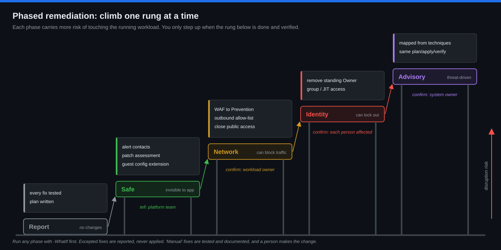
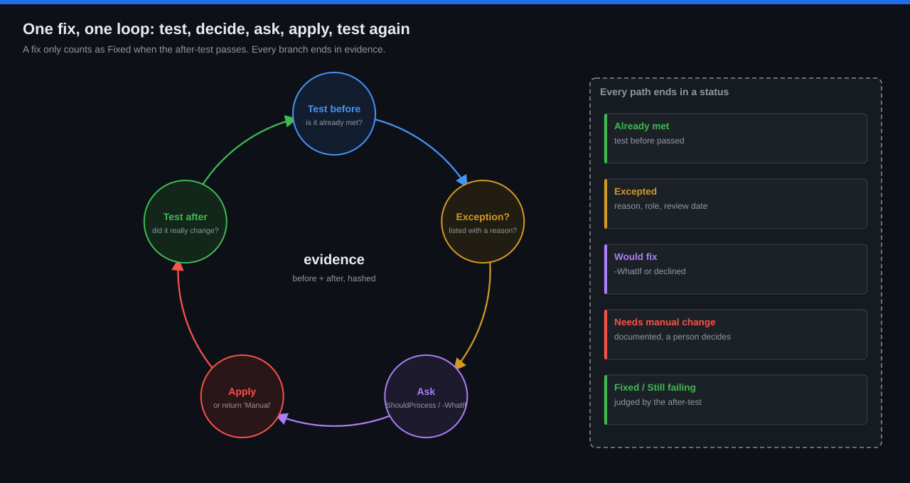
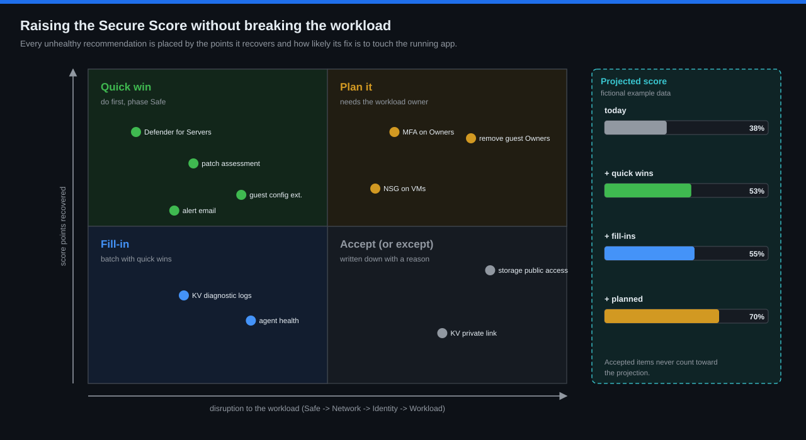

# Phased remediation kit (skeleton)

The rest of this repository only reads. This folder is the one place that **can change Azure**, and it is built so it never does so by surprise. It closes the findings that `azure-posture-check` and the rule register report, one phase at a time, safest first, with before-and-after evidence for every fix.



## Files

```
Invoke-PhasedRemediation.skeleton.ps1   the engine: test, decide, ask, apply, test again
fix-catalog.ps1                         the fixes, each with phase, disruption, test, apply, rollback
exceptions.example.json                 fixes that would break the workload, with reason and review date
Get-SecureScorePlan.skeleton.ps1        read-only: orders Defender recommendations into a safe plan
examples/secure-score-sample.json       FICTIONAL recommendations used by CI
advisory/                               turning a threat advisory into build changes
```

## Safety by design

| Guard | How |
|---|---|
| Nothing changes by default | `-Phase Report` is the default: every fix is tested, none applied |
| You are asked before every change | `SupportsShouldProcess`, `ConfirmImpact = High`. `-WhatIf` prints the plan and stops |
| "Fixed" means verified | each fix is tested before and after; the status comes from the after-test |
| The workload comes first | the exceptions register lists fixes that would break it. Excepted fixes are reported, never applied |
| Some changes belong to people | fixes such as removing standing Owner return `Manual`: tested and documented, applied by a person |
| A failed test is not a pass | a test that errors reports **Could not check** |



## Try it without a tenant

`-Demo` runs the engine against an in-memory fake state.

```powershell
./Invoke-PhasedRemediation.skeleton.ps1 -Demo                                   # Report: what needs fixing
./Invoke-PhasedRemediation.skeleton.ps1 -Demo -Phase Safe -WhatIf               # the plan, no changes
./Invoke-PhasedRemediation.skeleton.ps1 -Demo -Phase Safe, Network -Confirm:$false
```

The last run shows every outcome: Safe fixes become **Fixed**, the WAF fix becomes **Fixed**, the outbound allow-list is **Needs manual change**, and public storage access is **Excepted** because the example exceptions register says release uploads depend on it.

## Raising the Secure Score without breaking the workload

`Get-SecureScorePlan.skeleton.ps1` is read-only. It places each unhealthy recommendation by the points it recovers and how likely its fix is to touch the running app, then projects the score after each group.



```powershell
./Get-SecureScorePlan.skeleton.ps1 -RecommendationsFile ./examples/secure-score-sample.json
```

The disruption map at the top of the script (keyword to Safe / Network / Identity / Workload) is meant to be tuned for each workload. That tuning is where the knowledge of the application lives.

## Threat advisories

[advisory/](advisory/) holds the method for turning an advisory into a technique-to-control map and a short list of fixes in the `Advisory` phase, with a fictional worked example.

## Adding a fix

Copy a block in `fix-catalog.ps1`. Give it a phase, an honest disruption rating, what to confirm with the workload owner first, a `Test` that returns `Compliant` and `Detail`, an `Apply` (or `'Manual'`), and a rollback in words. The engine needs no change.
