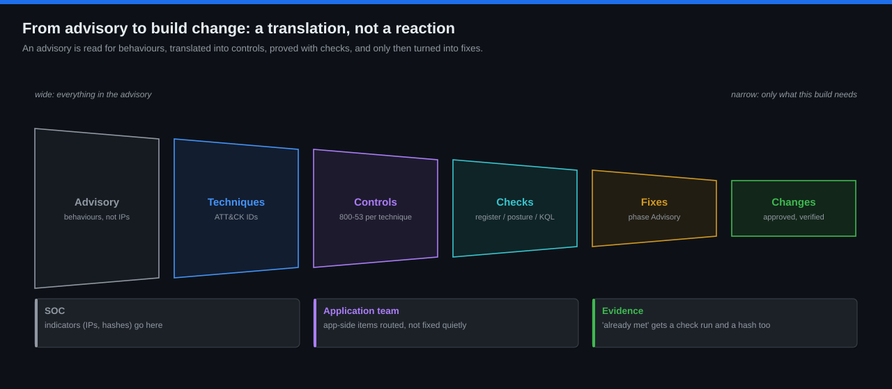

# Turning a threat advisory into build changes

When a government or vendor advisory lands, the useful question is not "are we affected?" but "which of our controls already answer each technique, and which do not?" This is the method I use. It produces a one-page map, a short list of fixes run through the phased remediation engine, and evidence for each decision. It never changes anything the workload depends on without that owner's agreement.

## The five steps

1. **Extract techniques.** Read the advisory for behaviours, not indicators. Each behaviour becomes a MITRE ATT&CK technique ID. Indicators (IPs, hashes) go to the SOC, not the build.
2. **Map to controls.** For each technique, name the NIST SP 800-53 controls that answer it.
3. **Find the check.** Point at the rule register row, posture check or KQL rule that proves the control today. No check means the first fix is to add one.
4. **Decide the fix.** Pick an existing fix from `fix-catalog.ps1` or add one to the `Advisory` phase. Record the workload impact and who must confirm it.
5. **Run and evidence.** `-Phase Report`, then `-Phase Advisory -WhatIf`, then apply with approval. Keep the before and after evidence with the map.

## The map

One row per technique ([advisory-map.example.json](advisory-map.example.json) is a fictional example):

| Technique | Controls | Check that proves it | Fix | Workload impact | Decision |
|---|---|---|---|---|---|
| T1078.004 Valid cloud accounts | AC-2, IA-2(1) | R-ID-04 | FX-I01 | None once the build account is in a group | Apply |
| T1098.001 Additional cloud credentials | AC-2(4), AU-6 | `app-credential-added.kql` | FX-A01 | None (detect only) | Apply |
| T1190 Exploit public-facing app | SC-7, SI-4 | R-NW-01/02, WAF mode | FX-N01 | Webhook paths need Allow rules first | Apply after log review |
| T1567 Exfiltration over web service | SC-7(5) | FX-N02 test | FX-N02 | Needs the full outbound list | Plan with owner |
| T1485 Data destruction | CP-9, CP-10 | R-BK-01, R-KV-01 | none | None | Already met, record evidence |

## Rules I hold to

- **Scope stays where it is.** An infrastructure engagement answers techniques with infrastructure controls. Application-side items are written down and routed to the application team, not fixed quietly.
- **"Already met" needs evidence too.** A technique the build already answers gets a check run and a hash, the same as a new fix.
- **No emergency exceptions to the process.** Urgency changes the order of the phases, not the plan, approve and verify steps.
