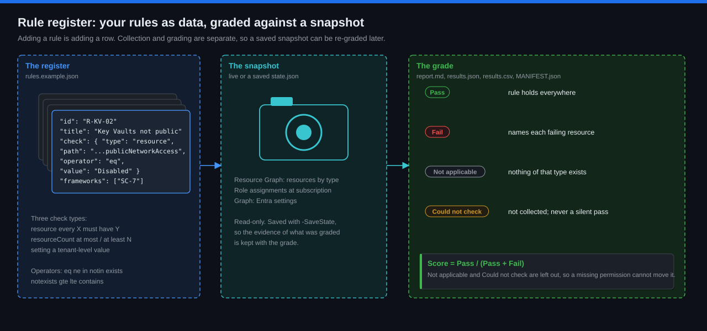

# Rule register check (skeleton)

`azure-posture-check` asks *"is this subscription hardened?"* with a fixed set of checks. This folder asks a different question: *"is the tenant still obeying **our** rules?"*

The rules are written down as data, one JSON row each, with their own severity and framework references. The grader reads the register, takes a read-only snapshot of the tenant, and grades every rule. Adding a rule means adding a row, not writing code.



## Files

```
Invoke-RuleRegisterCheck.skeleton.ps1   load register, collect state, grade, write evidence
RuleRegister.psm1                       pure grading functions (unit tested in ../tests)
rules.example.json                      13 example rules across Entra, Key Vault, storage, VMs, network, backup, logging
examples/sample-state.json              a FICTIONAL tenant snapshot used by CI
```

## Try it without signing in

```powershell
./Invoke-RuleRegisterCheck.skeleton.ps1 -StateFile ./examples/sample-state.json
```

```
RuleId  Status Severity Title
------  ------ -------- -----
R-ID-01 Fail   High     Only admins and guest inviters can invite guests
R-ID-04 Fail   High     No user holds standing Owner on the subscription
R-KV-02 Fail   High     Key Vaults are not reachable from public networks
R-BK-01 Fail   Medium   Recovery vaults have immutability enabled
...
Score 69.2%  |  9 pass, 4 fail
```

Each run writes `report.md`, `results.json`, `results.csv` and a SHA-256 `MANIFEST.json`. Live runs can also keep the snapshot (`-SaveState`), so the evidence of *what was graded* sits next to the grade and can be re-graded later against a newer register.

## Writing a rule

```json
{
  "id": "R-KV-02", "title": "Key Vaults are not reachable from public networks", "scope": "Azure", "severity": "High",
  "check": { "type": "resource", "resourceType": "microsoft.keyvault/vaults",
             "path": "properties.publicNetworkAccess", "operator": "eq", "value": "Disabled" },
  "frameworks": ["800-53 SC-7", "CSF PR.IR-01"]
}
```

| Check type | Meaning | Fields |
|---|---|---|
| `resource` | every resource of a type must satisfy a condition | `resourceType`, `path`, `operator`, `value`, optional `where` |
| `resourceCount` | how many of a type may exist | `resourceType`, `min` and/or `max`, optional `where` |
| `setting` | a tenant-level value | `path` under `settings`, `operator`, `value` |

Operators: `eq`, `ne`, `in`, `notin`, `exists`, `notexists`, `gte`, `lte`, `contains`. Paths are dotted and case-insensitive; numeric segments index arrays (`properties.ipConfigurations.0.properties.publicIPAddress`).

## Grading rules

- **Pass / Fail** count toward the score. **Not applicable** (nothing of that type exists) and **Could not check** (not collected, unknown type, error) do not, so a missing permission can never move the score in either direction.
- A failed rule names each failing resource.
- Graph collection for Entra settings is a `TODO` in the skeleton; those rules report **Could not check**, never a guess.
